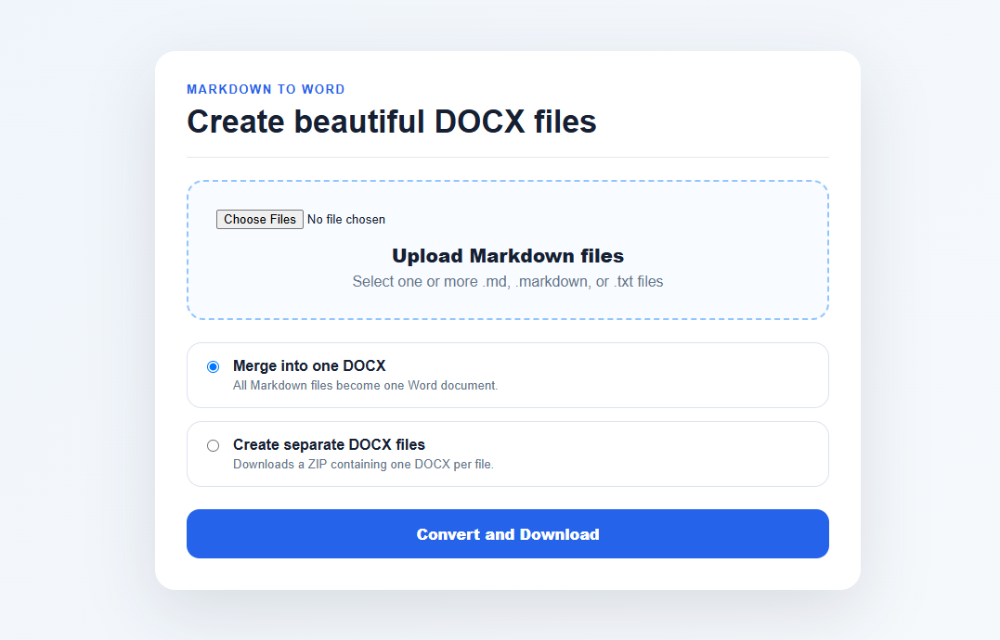

# Markdown to Word Flask App



Upload multiple Markdown files and download them as Word documents.

## Features

- Upload multiple `.md`, `.markdown`, or `.txt` files
- Convert all files into one merged `.docx`
- Convert each file into a separate `.docx` inside a ZIP
- Clean Word formatting for headings, lists, code blocks, quotes, and tables

## Setup

```bash
python -m venv venv
source venv/bin/activate
pip install -r requirements.txt
python app.py
```

On Windows:

```bash
python -m venv venv
venv\Scripts\activate
pip install -r requirements.txt
python app.py
```

Open:

```text
http://127.0.0.1:5000
```
